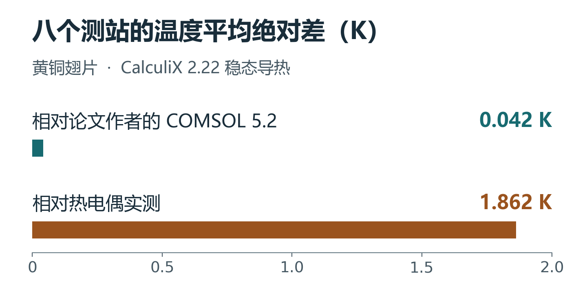

# NaviField Open

读到一篇用 COMSOL 或 Fluent 做仿真的论文，怎样用开源工具复算其中的温度、压降或应力？NaviField Open 为研究生和工程师公开建模输入、求解步骤和结果读回工具。你可以从一个案例开始，在自己的电脑上改参数、重算，再把同一个物理量与论文对照。

## 黄铜翅片：离开加热端，温度怎样下降？

Çakmak 与 Taylan 研究了一根底端加热、侧壁向空气散热的黄铜圆棒。他们用 COMSOL 5.2 预测沿棒身的稳态温度，并用热电偶测温。本例按论文的名义工况，由开源求解器 **CalculiX 2.22** 求解三维稳态导热。侧壁采用已包含自然对流和辐射的综合换热系数，末端绝热。

为了让这次计算可以修改和复做，NaviField 开发了三步工具。

1. **参数化建模。** 修改圆棒尺寸、导热率、底端温度、环境温度或侧壁换热系数，即可重新生成三维网格、材料和边界条件，写成 CalculiX 输入文件。
2. **调用求解器。** 在新项目目录中运行本机安装的 CalculiX，保存实际使用的输入、求解日志和原生结果文件，供随后复查。
3. **读回温度，校核热收支。** 在与论文对应的八个轴向测站，从原生节点温度按截面外周边长加权，得到每站的表面平均温度。再计入底端与侧壁共用节点分担的散热量，核对底端供热与整个侧壁散热是否相等。

**八个测站的温度平均绝对差**，相对论文作者的 **COMSOL 5.2 结果为 0.042 K**，相对**热电偶实测为 1.862 K**。前者衡量两种模型在同一名义工况下的差异，后者衡量模型预测与实物测量的差异。论文未披露热电偶埋深和整套实验的验收阈值。



**[复算黄铜翅片](examples/cli-v01/brass-fin/README.md)** · [阅读原论文](https://doi.org/10.17482/uumfd.446304)

[提交论文或仿真需求](https://github.com/navifield/navifield/issues/new?template=simulation-request.yml) · [反馈 Bug](https://github.com/navifield/navifield/issues/new?template=bug-report.yml)

NaviField Open helps students and engineers reproduce published simulation results with open-source solvers. Each example shows how to build the model, run it locally, and compare a physical quantity with a published prediction or measurement.

## 安装

知识库可离线查询 9 款软件的 678 条工程能力、23 种求解链和 34 条论文记录。先按具体物理量或 DOI 查询，再按需要展开模型、耦合方向、证据和待补输入。

```bat
navifield capabilities list
navifield capabilities paper-cases --doi 10.17482/uumfd.446304
navifield capabilities chain-inventory --chain steady_extended_surface_conduction --solver calculix --version 2.22
navifield capabilities couplings --solver elmer
```

自然语言选型使用 `navifield route request.json --brief`，文件格式如 `{"original_request":"细长铝棒基部定温，末端绝热，侧面有综合换热系数，想算轴向温度和基部传热率。"}`。首次筛选可能只得到部分候选或无匹配记录。资料目录随包提供原始 JSON 与 SQLite 查询索引。每篇论文的原生计算、文献数据与实验验收状态分别记录。[知识库数据和证据说明](navifield/capability_data/PUBLIC_EVIDENCE_BOUNDARY.txt)

准备 64 位 Python 3.10 或更新版本。在解压目录打开 Windows 命令提示符（cmd.exe），建议为 NaviField 建独立环境。安装命令会一并安装基础依赖 psutil 和 Pydantic 2。

```bat
py -3 -m venv .venv
call .venv\Scripts\activate.bat
python -m pip install .
```

需要绘图时，可在同一目录安装含 NumPy、PyVista、VTK 和 Matplotlib 的可选依赖组，执行 `python -m pip install ".[plots]"`。常规运行记录和文字 HTML 报告可用基础安装。命令 `navifield` 和解压目录里的 `navifield.cmd` 均可使用。以下示例保留在解压目录中运行。

## 配置 Windows 求解器

从[第三方程序与官方下载地址](https://github.com/navifield/navifield/blob/main/THIRD_PARTY_NOTICES.md)获取本例需要的程序。梁使用 CalculiX，方腔使用 OpenFOAM，八进程圆管还需要与该构建匹配的 Microsoft MPI。NaviField 提供配置脚本，求解器和 DLL 由各自发行方提供。

梁例只需将 `NAVIFIELD_CCX_BIN` 设为实际含 `ccx.exe` 及其配套 DLL 的目录。输入以下命令时，先把尖括号和其中的文字换成自己的路径。

```bat
set "NAVIFIELD_CCX_BIN=<CalculiX 的 bin 目录>"
call configure-toolchain.cmd
```

脚本只设置当前 cmd 会话。`NAVIFIELD_PYTHON` 是运行示例脚本和 CLI 的 Python 解释器，默认使用已激活虚拟环境的 python.exe；也可自行设为该解释器的完整路径。Linux 上命令行工具可运行，求解器环境需自备。

## 三步运行公开梁示例

以下命令使用上面已配置的环境，并创建新的案例目录。

**1. 创建案例**

```bat
"%NAVIFIELD_PYTHON%" examples\cli-v01\beam\make_case.py work\beam\case
```

**2. 运行求解器**

```bat
navifield.cmd run --project work\beam --cwd case --cores 8 --wall-seconds 870 -- ccx -i beam
```

**3. 检查计算并查看记录**

```bat
"%NAVIFIELD_PYTHON%" examples\cli-v01\beam\check.py work\beam\case
navifield.cmd show --project work\beam --rid r001
```

一次实际运行的完整终端输出（运行号和墙钟秒数随当次运行变化）：

```text
work\beam\case
r001
tip_mean_down_mm=0.190122717; euler_bernoulli_mm=0.19047619; relative_error=0.00185574; limit=0.02
{"run_id": "r001", "state": "completed", "exit_code": 0, "cores": 8, "wall_seconds": 0.779568, "details": ".navifield/records/r001.json"}
```

该梁例将端面平均挠度与 Euler–Bernoulli 解析值比较，短梁剪切变形可能造成模型差异；它不替代具体工程验收。

## 其他命令

```bat
navifield.cmd run --project work\my-project --cwd case --background --cores 8 --wall-seconds 900 -- solver.exe argument1
navifield.cmd wait --project work\my-project --rid r001
navifield.cmd status --project work\my-project --rid r001
navifield.cmd show --project work\my-project --rid r001
navifield.cmd report --project work\my-project --rid r001
navifield.cmd self-check --project work\my-project --rid r001
navifield.cmd monitor --project work\my-project
navifield.cmd stop --project work\my-project --rid r001
```

先在项目下创建 `case` 并放入输入；`--` 后每项为程序和参数，不经过 shell。`--input 项目相对路径` 可重复指定其他项目内输入。运行号以实际输出为准。`report` 和 `self-check` 返回 HTML 路径；`self-check` 可重复 `--rid` 合看多个运行，并以 `--facts`、`--monitor` 或 `--absolute-pressure` 传入用户明确提供的数据，缺失项不会被推断。

`status` 和 `show` 默认返回简短 JSON 及记录/日志路径，`status` 不修改项目；加 `--full` 输出完整机器可读结果。`wait` 通常返回完整一行 JSON；表或残差很多时返回代表性末值及完整 JSON 路径，加 `--full` 输出全部内容。可加 `--timeout 秒`、`--residual-below 值`、`--then-stop` 或 `--stop-on-divergence`；停止只是请求，须确认终态。

`wait` 的退出码为 **0**（运行成功完成）、**3**（返回时仍在运行，例如等待超时或刚发出停止请求）、**1**（其他终态或无法确认状态）。同时读 JSON 的 `state` 和 `reason`。

### 运行监控

`wait` 和 `monitor` 只识别 OpenFOAM 样式日志中的残差。其他求解器仍可查看可识别的监测表和日志末尾。网页最多绘制 8 条残差曲线，其余方程列在数值表中。`monitor` 只监听本机 `127.0.0.1:8790`，按 Ctrl+C 结束；在其他电脑浏览时可通过 SSH 转发该端口。

## 网格转换与其他公开例

```bat
"%NAVIFIELD_PYTHON%" tools\mesh_convert.py mesh.msh --case work\my-case
```

案例须先有 `system/controlDict` 且不存在 `constant/polyMesh`。转换器默认是 PATH 中的 `gmshToFoam`，可用 `--converter` 指定；完整原生日志写入案例的 `gmshToFoam.log`，已有日志不覆盖，可用 `--log` 指定新文件。检查退出码、网格质量及边界名称、类型和面数。

方腔与圆管的完整输入生成器及检查脚本位于 `examples/cli-v01/cavity` 和 `examples/cli-v01/pipe`。它们分别与 [Ghia 等人的 Re=1000 结果](https://doi.org/10.1016/0021-9991(82)90058-4)及 [IAEA 手册的 Blasius 摩擦关系](https://www-pub.iaea.org/MTCD/publications/PDF/CRCP_SOD_003web.pdf)比较；先按案例实际环境依次运行网格生成、网格检查、求解和检查脚本。

### 方腔：顺序执行

使用 Windows MinGW 版 OpenFOAM。把项目根目录设为含 `etc\controlDict` 的目录；脚本默认在其 `platforms\win64MingwDPInt32Opt\bin` 寻找求解器。如果可执行文件在别处，再设 `NAVIFIELD_FOAM_BIN`。

```bat
set "NAVIFIELD_FOAM_ROOT=<OpenFOAM 项目根目录>"
call configure-toolchain.cmd
```

从解压根目录、激活工具链后执行：

```bat
"%NAVIFIELD_PYTHON%" examples\cli-v01\cavity\make_case.py work\cavity\case
navifield.cmd run --project work\cavity --cwd case --wall-seconds 30 -- blockMesh
navifield.cmd run --project work\cavity --cwd case --wall-seconds 30 -- checkMesh -allTopology -allGeometry
navifield.cmd run --project work\cavity --cwd case --wall-seconds 780 -- simpleFoam
navifield.cmd run --project work\cavity --cwd case --wall-seconds 30 -- simpleFoam -postProcess -latestTime
"%NAVIFIELD_PYTHON%" examples\cli-v01\cavity\check.py work\cavity\case
navifield.cmd report --project work\cavity --rid r003
```

### 圆管：八进程执行

在上面的 OpenFOAM 环境中，将 `NAVIFIELD_MPI_BIN` 指向 Microsoft MPI 的 `mpiexec.exe` 所在目录。若 OpenFOAM 的默认通信库是串行 dummy，而发行目录提供 `libPstream.dll-msmpi`，用下面的命令在新目录准备并行副本。已配置为 MS-MPI 的发行环境可省略 `NAVIFIELD_PARALLEL_BIN`。若需要明确指定与启动器匹配的 DLL，可在调用配置脚本前设置 `NAVIFIELD_MPI_DLL` 为所安装的 `msmpi.dll` 完整路径。

```bat
set "NAVIFIELD_MPI_BIN=<Microsoft MPI 的 Bin 目录>"
set "NAVIFIELD_PARALLEL_BIN=%CD%\work\openfoam-msmpi-bin"
call configure-toolchain.cmd
```

首次配置会从你自己的 OpenFOAM 安装复制可执行目录，在副本中启用随安装提供的 MS-MPI 变体；以后同一路径将复用。更换 OpenFOAM 或 MPI 版本时，请指定新的并行目录。

本例依次生成网格、分区、八进程求解并重构：

```bat
"%NAVIFIELD_PYTHON%" examples\cli-v01\pipe\make_case.py work\pipe\case
navifield.cmd run --project work\pipe --cwd case --wall-seconds 20 -- blockMesh
navifield.cmd run --project work\pipe --cwd case --wall-seconds 20 -- checkMesh -allTopology -allGeometry
navifield.cmd run --project work\pipe --cwd case --wall-seconds 20 -- decomposePar
navifield.cmd run --project work\pipe --cwd case --cores 8 --wall-seconds 800 -- mpiexec -n 8 simpleFoam -parallel
navifield.cmd run --project work\pipe --cwd case --wall-seconds 20 -- reconstructPar -latestTime
"%NAVIFIELD_PYTHON%" examples\cli-v01\pipe\check.py work\pipe\case
navifield.cmd report --project work\pipe --rid r004
```

若希望把本次求解的残差和监测表绘成曲线，可在安装绘图依赖后运行 `navifield.cmd report --project work\pipe --rid r004 --plots`。实际运行号以各命令输出为准。圆管比较前还应检查流动发展、质量守恒及壁面 y+。

## 已知局限

- 停止采用进程树终止请求，求解器可能不会写出最新场或安全检查点；状态 `unknown` 不是成功。
- OpenFOAM 残差低于阈值、程序退出0或自检有结果，都不等于结果可交付。仍需检查物理输入、网格、监控量、守恒、网格敏感性及适用参考。
- 运行时仅复制不超过1 MiB的案例文件；大文件记录大小和时间，复制失败会提示。监测表单位不自动推断。
- 梁的解析解、方腔的文献数据和圆管经验关联分别有适用条件；单一网格不能证明网格无关。报告和自检列事实及缺项，不作工程通过判定。

OpenFOAM® 为其商标持有方的商标；本项目与其无关联，未获其认可。许可证和依赖状态见 `LICENSE`、`NOTICE`、`THIRD_PARTY_NOTICES.md`。
