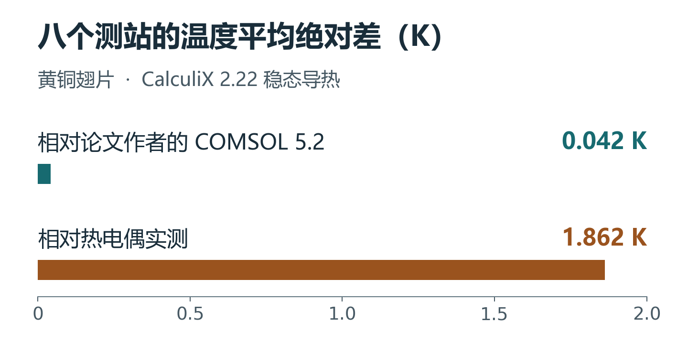

# 黄铜翅片的稳态温度

加热黄铜圆棒的一端，沿棒身的表面温度会怎样下降？Çakmak 与 Taylan 用热电偶测量黑漆圆棒的温度，并用 COMSOL 5.2 预测稳态温度分布。这里按论文的名义工况，用 **CalculiX 2.22** 求解三维稳态导热，再与作者表 1 的两组结果分别比较。[论文与表 1](https://doi.org/10.17482/uumfd.446304)

## 从模型到八个测站

1. **参数化建模。** NaviField 根据圆棒尺寸、黄铜导热率、基温、环境温度和侧壁综合换热系数生成 DC3D8 网格与 CalculiX 输入。基端定温，末端绝热。论文的侧壁系数已含自然对流和辐射，模型用一道膜边界计入两者。
2. **调用本机求解器。** NaviField 在新项目目录中运行 CalculiX，保留实际输入、日志和原生 DAT。算完以后，才读取论文参考温度作对照。
3. **读回和校核。** 在论文有读数的八个轴向测站，先对截面各条外边的两个端点取平均，再按边长加权，算出该站的表面平均温度。汇总底端热反力，并计入底端与侧壁共享节点分担的散热，再与整个侧壁的散热积分比较。细网预测的底端供热约为 2.366 W。

## 与论文对照

以八个测站为一组，对各站的温差取绝对值再求平均。CalculiX 2.22 相对**论文作者的 COMSOL 5.2 结果**，温度平均绝对差为 **0.042 K**。相对**热电偶实测**，温度平均绝对差为 **1.862 K**。前者比较同一名义工况的两次数值预测，后者比较预测与实物读数。论文中 ST1 和 ST9 因故障缺测，热电偶埋深和整体验收阈值未披露。



[公开版工作站复核记录](https://github.com/navifield/navifield/releases/download/v0.2.0/brass-fin-workstation-verification.json)

## 从发行源码运行

从 [v0.2.0 发行页](https://github.com/navifield/navifield/releases/tag/v0.2.0) 下载 `navifield-0.2.0-source.zip` 并解压，在源码根目录执行下列 Windows 命令。需要 Python 3.10 及以上和可独立运行的 CalculiX 2.22。将示例中的求解器路径替换为本机位置，并保留发行方配套的 DLL。[公开求解器获取方式](../../../THIRD_PARTY_NOTICES.md)

```bat
py -3 -m venv .venv
.venv\Scripts\python -m pip install ".[fin]"
.venv\Scripts\python examples\cli-v01\brass-fin\run.py --ccx "C:\solver\bin\ccx.exe" --project work\brass-fin-01
```

运行目录须为新目录。成功后，`comparison.json` 含八点温度、与三组参考数据的差异及最大复算误差。`readback.json` 含截面读数和热收支。项目中还保留输入文件、原生 DAT 和作业记录。示例先生成网格并独立求解，再读取参考温度。复算判据为相对先前同网格 CalculiX 2.22 结果逐点绝对差均不超过 0.001 K。

## 更改工况或单独调用

`model.json` 给出长度 0.327 m、半径 0.005 m、导热率 110 W/(m·K)、基温 57.4 °C、环境温度 20.5 °C、侧壁综合换热系数 15.7 W/(m²·K)。截面每方向 8 等分，8 个轴向内部位置把长度分成 9 段，每段 4 等分，共 2304 个单元。

以下分步命令使用已激活的虚拟环境，并假定 `ccx` 已加入 PATH。`fin read` 演示指定两个位置，一键复算脚本会读回全部八站。

```bat
navifield fin build examples\cli-v01\brass-fin\model.json --deck model.inp
ccx -i model
navifield fin read --deck model.inp --dat model.dat --positions-m 0.045 0.075
navifield capabilities paper-cases --doi 10.17482/uumfd.446304
```

读取位置从基端沿轴向计量，单位为 m。读回结果保留输入文件和原生 DAT 的 SHA-256，可用来识别本次计算。[返回公开案例目录](../README.md)
